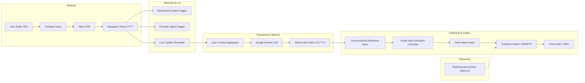

# Live Brain

> Ultra-low-latency, real-time voice and avatar technical interview engine built with Pipecat.

## Architecture



## Quick Start

### 1. Environment Setup

```bash
python -m venv .venv
source .venv/bin/activate  # On Windows: .venv\Scripts\activate
pip install -r requirements.txt
```

### 2. Configuration

Copy the sample environment file and add your service credentials:

```bash
cp .env.example .env
```

Verify your environment configuration using the status checker:

```bash
python tools/check_env.py
```

### 3. Run Test Suite

Run the offline automated test suite:

```bash
python -m pytest
```

### 4. Run the Engine

Run with the Pipecat runner:

```bash
python -m live_brain.bot
```

## Production Stack as Wired in Code

- **Speech-to-Text (STT):** `ResilientDeepgramSTTService` using model `nova-3` with `smart_format=True`, `punctuate=True`, `interim_results=True`, synchronized WebSocket concurrency locks, and 5-second keepalive frames.
- **Large Language Model (LLM):** `GoogleLLMService` with `gemini-3.5-flash-lite` (or configured via `GEMINI_MODEL`), evaluating conversational context against strict-sequence question blueprints from `QuestionBank`.
- **Text-to-Speech (TTS):** `ElevenLabsTTSService` using model `eleven_flash_v2_5`, streaming audio with word-level alignment and an 8.0s silence-tolerant watchdog.
- **Visual Avatar:** `ResilientSimliVideoService` featuring exponential connection retries (max 3 attempts) with graceful, seamless fallback to audio-only delivery.

## Key Design Decisions

1. **Audio-Only Default & Decoupled Avatar:**
   Avatar rendering (Simli) is an optional enhancement layer rather than a hard dependency. If `ENABLE_AVATAR` is set to false or Simli credentials are not configured, the pipeline automatically bypasses the video stage without crashing or interrupting the audio conversation.

2. **Removal of Gaze & Visual Scoring:**
   Vision-based gaze estimation, head pose tracking, and facial emotion metrics were intentionally removed from the pipeline. Physical webcam angles, lighting variations, and monitor setups produce high false-positive rates for eye contact. More critically, inferring emotional state, nervousness, or candidate suitability from facial geometry is scientifically unreliable and contravenes EU AI Act prohibitions against automated biometric emotion recognition in employment settings.

3. **Descriptive-Only Behavioral Coaching Telemetry:**
   All behavioral taggers (filler words, hedging phrases, repeated words, pitch variation, speaking rate) function as passive taps off the transcription and audio streams. They produce strictly descriptive observations (e.g. word counts, timestamps) rather than evaluative scoring or judgment, keeping the engine neutral and compliant.

## Latency Instrumentation & Benchmarks

Turn latency is tracked across discrete pipeline stages using non-blocking observer taps:
- **Stage 1:** Speech-end (Silero VAD) to STT final transcript
- **Stage 2:** STT transcript to first LLM token
- **Stage 3:** First LLM token to first TTS audio byte
- **Stage 5:** Speech-end to first substantive bot audio delivered at transport output

> [!NOTE]
> Latency performance numbers are to be measured in your target deployment environment; run `python tools/summarize_latency.py` against `.tmp/latency.jsonl` to generate percentile distributions (p50, p95, min, max). Note that the avatar stage is not reported in the summary table.

## Limitations

- **Single Speaker Assumption:** The VAD and STT pipeline does not perform multi-speaker diarization; it assumes one candidate audio channel.
- **Turn Gap Measurement:** The behavioral tagger operates upstream of the LLM/TTS stages; turn gap measurements reflect time between candidate utterances rather than interviewer-delimited pauses.
- **Network Dependency:** End-to-end responsiveness depends on network round-trip latency to cloud inference endpoints (Deepgram, Gemini, ElevenLabs).
- **Simli Task Monitoring:** A stalled (as opposed to crashed) Simli connection requires connection-level keepalive detection.

## License

MIT License. Copyright (c) 2026 Aki.
